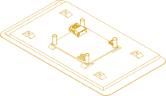

# //pub/electronics/sbcs/raspberrypi

Raspberry Pi

## Parts

### rpi-touchscreen
<table><tr>
<td valign=top></td>
<td valign=top>Raspberry Pi 7" Touchscreen Display</td>
</tr></table>

### rpi3b
<table><tr>
<td valign=top></td>
<td valign=top>Raspberry Pi 3 Model B</td>
</tr></table>

### rpi3bplus
<table><tr>
<td valign=top></td>
<td valign=top>Raspberry Pi 3 Model B+</td>
</tr></table>

### rpi4b
<table><tr>
<td valign=top></td>
<td valign=top>Raspberry Pi 4 Model B</td>
</tr></table>

  

*Generated by [PartCAD](https://partcad.org/)*
